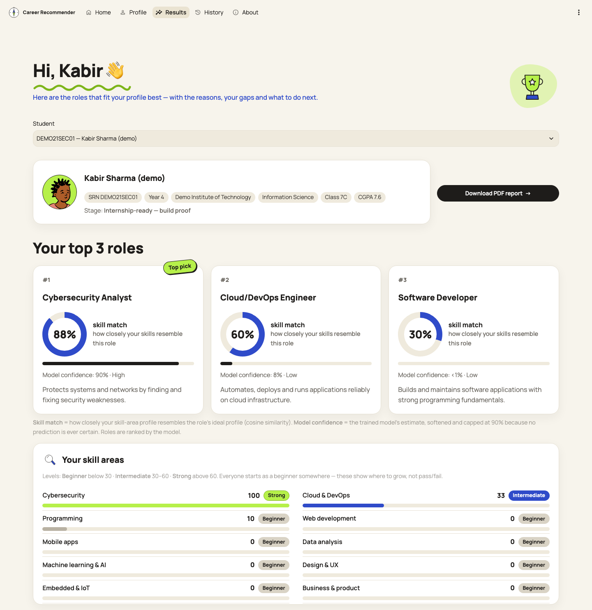
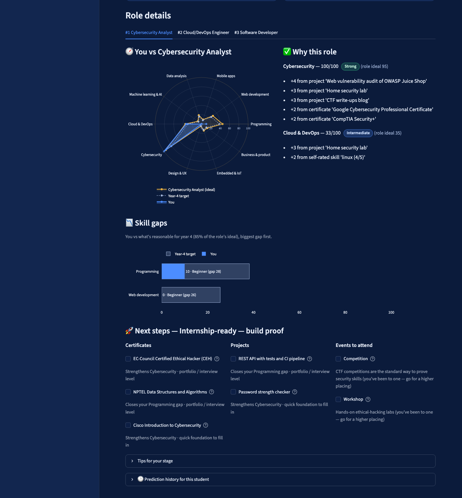
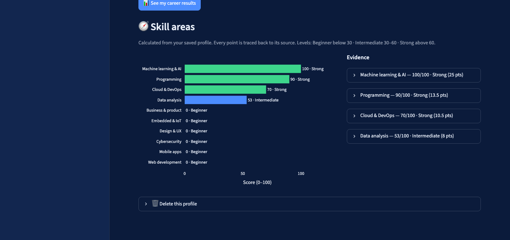
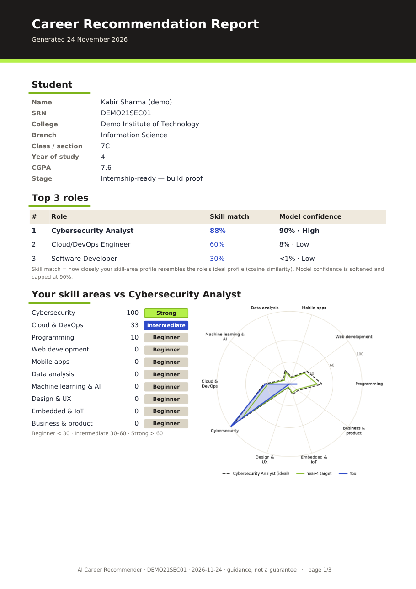
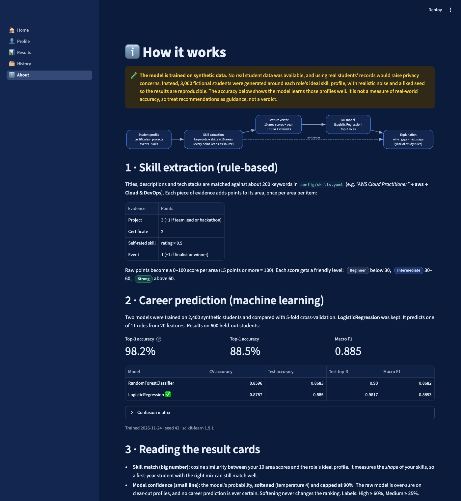
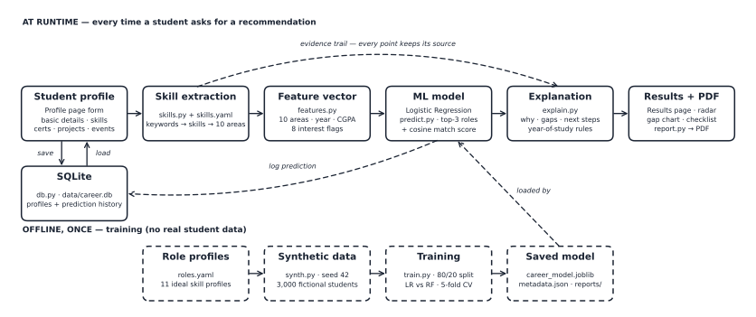

# 🎯 AI Career Recommender

A college mini-project that recommends **job roles that suit a student**, explains **why**, shows
their **skill gaps** and suggests **next steps**.

A student enters their academic profile: college, SRN, class, year of study, certificates,
projects and events attended. The app scores their skills in 10 areas, predicts their **top 3
roles** with a machine-learning model, and turns that into advice they can act on. It runs fully
offline on a laptop, with no paid APIs and no LLM calls.



---

## 1. Overview & screenshots

| Results: why, gaps, next steps | Profile: skill areas with evidence |
|---|---|
|  |  |

| PDF report | About: how the model works |
|---|---|
|  |  |

All screenshots show **fictional demo students**.

## 2. Features

- **Student profile:** basic details (SRN validated against a configurable pattern), self-rated
  skills, interests, and repeatable lists of **certificates, projects and events**, which you can
  add, edit and delete. Profiles are saved in SQLite and reloaded by SRN. Validation errors appear
  under each field.
- **Explainable skill extraction:** about 200 keywords map certificate, project and event text to
  skills, and skills to 10 areas. **Every point keeps its source**, e.g.
  *"Cloud & DevOps +2 from certificate 'AWS Cloud Practitioner'"*.
- **Skill levels:** each area score is labelled **Beginner** (< 30), **Intermediate** (30–60) or
  **Strong** (> 60), so low numbers read as "room to grow", not failure.
- **Career prediction:** a trained model ranks 11 roles. The **top 3** are shown with:
  - **Skill match** (the headline number): cosine similarity to the role's ideal profile
  - **Model confidence**: softened and capped at 90%, so results stay believable
- **Why / gaps / next steps:**
  - **Why:** the strongest areas behind each role, with the exact evidence.
  - **Gaps:** measured against a **year-adjusted target** and ranked by size.
  - **Next steps:** 2–3 certificates, 1–2 project ideas and 1–2 event types.
    - Years 1–2 get *explore* advice.
    - Years 3–4 get *internship-ready* advice.
    - Anything the student has already done is skipped.
- **Results dashboard (navy theme):**
  - student card
  - role cards
  - radar chart (you vs the role's ideal vs your year's target)
  - gap chart
  - next-steps checklist
  - prediction history
- **PDF report:** `<SRN>_career_report.pdf`, with the same content, ready to print.
- **Demo mode:** load one of 3 fictional students with one click (Home or Profile page).

## 3. How it works

<picture>
  <source media="(prefers-color-scheme: dark)" srcset="docs/architecture-dark.svg">
  
</picture>

1. **Profile → skill extraction** (`skills.py`). Each piece of evidence adds points to its area:
   project 3 (+1 if team lead or hackathon), certificate 2, self-rated skill rating × 0.5,
   event 1 (+1 if finalist or winner). Points become a 0–100 score per area.
2. **Features** (`features.py`): 10 area scores, year of study, CGPA and 8 interest flags (20 numbers).
3. **Model** (`predict.py`): Logistic Regression gives a probability for each of the 11 roles. The
   cosine **match score** is computed alongside, so the result is easy to explain.
4. **Explanation** (`explain.py`): why, gaps and next steps, using the role profiles in
   `config/roles.yaml` and the year-of-study rules in `config/app.yaml`.

More detail, including module responsibilities and the database schema, is in
[docs/architecture.md](docs/architecture.md). The diagram is outline-only on a transparent
background, so it can be reused on slides:
[`architecture.svg`](docs/architecture.svg) / [`.png`](docs/architecture.png) for light slides,
[`architecture-dark.svg`](docs/architecture-dark.svg) / [`.png`](docs/architecture-dark.png) for dark slides.
Regenerate with `python docs/make_architecture.py`.

## 4. Setup and run

Needs **Python 3.11+** and Git. Tested from a fresh clone on Python 3.12 and 3.14 (macOS).

**macOS / Linux**
```bash
git clone https://github.com/vshriwas051-code/career-recommender.git
cd career-recommender
python3 -m venv .venv
source .venv/bin/activate
pip install -r requirements.txt
streamlit run app.py
```

**Windows (PowerShell)**
```powershell
git clone https://github.com/vshriwas051-code/career-recommender.git
cd career-recommender
py -m venv .venv
.venv\Scripts\Activate.ps1
pip install -r requirements.txt
streamlit run app.py
```

The app opens at <http://localhost:8501>. To see it work straight away, choose a demo student
on the Home page and click **See demo results**.

| Task | Command |
|---|---|
| Run the tests | `pytest` |
| Retrain the model (≈30 s, identical result) | `PYTHONPATH=src python -m career.train` · Windows: `$env:PYTHONPATH="src"; python -m career.train` |
| Regenerate the architecture diagram | `python docs/make_architecture.py` |

The trained model is committed, so retraining is optional. If you see a scikit-learn version
warning on a newer install, retrain with the command above. Profiles are stored in
`data/career.db`, which is created automatically and git-ignored.

## 5. Model and evaluation

> **The training data is synthetic.** No real student data was available, and using real
> students' records would raise privacy concerns. `src/career/synth.py` generates **3,000
> fictional students** around each role's ideal skill profile, with realistic noise:
> - partial progress towards the ideal, depending on year of study
> - personal variation and measurement noise
> - side interests
> - optional CGPA
>
> It uses a fixed seed (42), so the dataset is identical every time. The scores below show that
> the model learns the role profiles well. They are **not** a measure of real-world accuracy.

- Split: 80/20, stratified (2,400 train / 600 test).
- Selection: Random Forest vs Logistic Regression, compared with 5-fold cross-validation on the
  training set only. The better one is kept.

| Model | CV accuracy | Test accuracy | **Test top-3 accuracy** | Macro F1 |
|---|---|---|---|---|
| **Logistic Regression ✅** | 0.879 | 0.885 | **0.982** | 0.885 |
| Random Forest | 0.860 | 0.868 | 0.980 | 0.868 |

The main mix-ups are between roles with genuinely overlapping skills, such as Data Scientist and
ML/AI Engineer, or Data Analyst and Business Analyst. That is why the app shows the top 3 rather
than one answer. The full report is in [reports/model_evaluation.md](reports/model_evaluation.md),
with the [confusion matrix](reports/confusion_matrix.png). Metadata (model type, seed, rows,
features, metrics and date) is in `models/metadata.json`.

Raw model probabilities are very sharp for clear-cut real profiles (often over 99.9%). For
display they are **softened** with temperature scaling and **capped at 90%**. This never changes
the ranking, and the raw value is still saved in the prediction history.

## 6. Project structure

```
career-recommender/
├── app.py                  Streamlit entry: home page + st.navigation
├── views/                  1_Profile.py · 2_Results.py · 3_History.py · 4_About.py
├── src/career/
│   ├── models.py           dataclasses: Student, Certificate, Project, Event
│   ├── db.py               SQLite schema + CRUD, prediction history
│   ├── validate.py         SRN / year / CGPA / date validation
│   ├── skills.py           keyword → skill → area extraction with evidence trail, levels
│   ├── features.py         profile → 20-number feature vector
│   ├── synth.py            synthetic training data (seed 42)
│   ├── train.py            train, compare, evaluate, save the model
│   ├── predict.py          top-3 roles, softened confidence, match score
│   ├── explain.py          why / gaps / next steps / year rules
│   ├── report.py           PDF report (fpdf2 + matplotlib)
│   ├── charts.py           Plotly charts for the pages
│   ├── demo.py             demo-profile loader
│   ├── config.py · ui.py   YAML config loading · shared CSS
├── config/                 skills.yaml · roles.yaml · app.yaml
├── models/                 career_model.joblib + metadata.json
├── reports/                model_evaluation.md · confusion_matrix.png
├── demo/                   3 fictional demo students (JSON)
├── docs/                   architecture.md · architecture*.svg/png · decisions.md · screenshots/
├── tests/                  pytest suite (unit + headless UI tests)
├── data/                   SQLite database (git-ignored, created on first run)
└── .streamlit/config.toml  navy theme
```

Design decisions and their reasons are logged in [docs/decisions.md](docs/decisions.md).

## 7. Limitations and future work

**Limitations**
- **Synthetic training data:** the model reflects the role profiles we wrote, not real hiring outcomes.
- **Keyword matching** can miss unusual wording, or credit a keyword in an unexpected context.
- **Self-ratings are subjective**, and certificates or projects aren't verified.
- **The "already done" check is word-based:** it may skip a suggestion that only looks similar to
  something the student has done.

**Future work**
- Train on **real, anonymised data**, with consent, e.g. alumni profiles and their first jobs.
- **Résumé upload**: extract certificates and projects from a PDF résumé automatically.
- **LLM-written advice**, as an optional layer on top of the explainable rules.
- Verify credentials via credential URLs; link next steps to course pages.
- Track progress over time using the stored prediction history.

---

Built with Python, Streamlit, scikit-learn, pandas, NumPy, Plotly, fpdf2, PyYAML, SQLite and pytest.
