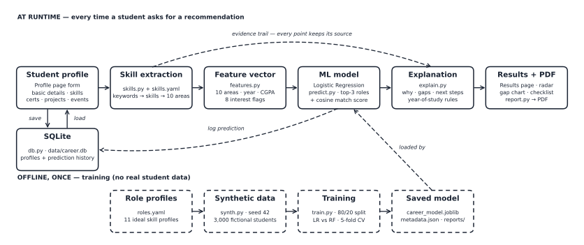

# Architecture

<picture>
  <source media="(prefers-color-scheme: dark)" srcset="architecture-dark.svg">
  
</picture>

Two flows:

- **At runtime** (solid boxes): every time a student asks for a recommendation.
- **Offline, once** (dashed boxes): training the model. It doesn't run when the app is used.

## Runtime flow

| Step | Module | Input → output |
|---|---|---|
| 1. Profile | `views/1_Profile.py`, `models.py`, `validate.py`, `db.py` | Form → validated `Student` → SQLite |
| 2. Skill extraction | `skills.py` + `config/skills.yaml` | `Student` → raw points + 0–100 score per area + **evidence list** |
| 3. Features | `features.py` | area scores + year + CGPA + interests → 20-number vector (fixed order) |
| 4. Prediction | `predict.py` + `models/career_model.joblib` | vector → probability per role → top 3 + cosine match + softened confidence |
| 5. Explanation | `explain.py` + `config/roles.yaml` + `config/app.yaml` | top 3 + evidence → why / gaps / next steps |
| 6. Presentation | `views/2_Results.py`, `charts.py`, `report.py` | cards, radar, gap chart, checklist, PDF |
| 7. History | `db.py` (`predictions` table) | each new profile version's top 3 is appended, never overwritten |

### Scoring rules (from `config/skills.yaml`)

| Evidence | Points to each area it touches |
|---|---|
| Project | 3, +1 if team lead or a hackathon project |
| Certificate | 2 |
| Self-rated skill | rating (1–5) × 0.5 |
| Event | 1, +1 if finalist or winner |

- Score = min(100, raw points ÷ 15 × 100).
- Levels: Beginner < 30 ≤ Intermediate ≤ 60 < Strong.
- An item counts **once per area**, however many keywords match.
- Longer keywords win, so "React Native" counts as Mobile, not Web.

### Display rules (from `config/app.yaml`)

- **Match** = cosine(student area vector, role ideal profile) × 100.
- **Confidence** = model probability, temperature-scaled (T = 4) and capped at 90%. Shown as
  "<1%" rather than "0%".
- **Gap target** = role ideal × 40 / 55 / 70 / 85% for years 1–4. Only areas with ideal ≥ 25 and
  a gap ≥ 5 are shown.
- **Next steps**: level from the year stage (1–2 beginner, 3–4 advanced). Suggestions closing
  the biggest gap come first, and anything already done is skipped.

## Offline training flow

`roles.yaml` (11 ideal profiles) → `synth.py` (3,000 students, seed 42) → `train.py`:

1. 80/20 stratified split.
2. Logistic Regression vs Random Forest, compared with 5-fold CV.
3. The winner is evaluated on the test set.

Outputs: `models/career_model.joblib`, `models/metadata.json`, `reports/model_evaluation.md`,
`reports/confusion_matrix.png`.

## Database (SQLite, `data/career.db`)

| Table | Key columns |
|---|---|
| `students` | **srn** (PK), name, college, branch, class_section, year_of_study, cgpa, interests (JSON), skills (JSON), created_at, updated_at |
| `certificates` | cert_id (PK), srn (FK), title, issuer, platform, domain, completion_date, credential_url |
| `projects` | project_id (PK), srn (FK), title, description, tech_stack (JSON), role, project_type, github_url |
| `events` | event_id (PK), srn (FK), name, event_type, theme, event_date, participation |
| `predictions` | prediction_id (PK), srn (FK), created_at, model_version, top_roles (JSON), area_scores (JSON) |

- Foreign keys are on, and deleting a student cascades to all their rows.
- Students are saved with an UPSERT (never `INSERT OR REPLACE`), so prediction history survives edits.

## UI structure

`app.py` defines the home page and registers the pages with `st.navigation`:

- `views/1_Profile.py`: form, load by SRN, demo loader, skill areas + evidence
- `views/2_Results.py`: cards, levels, radar, why, gaps, next steps, PDF, history
- `views/3_History.py`: saved profiles; open or delete by SRN
- `views/4_About.py`: method, metrics, synthetic-data note, limitations

Page scripts live in `views/`, not `pages/`. A folder named `pages/` would be auto-discovered by
Streamlit, and direct links would bypass `st.navigation`.
