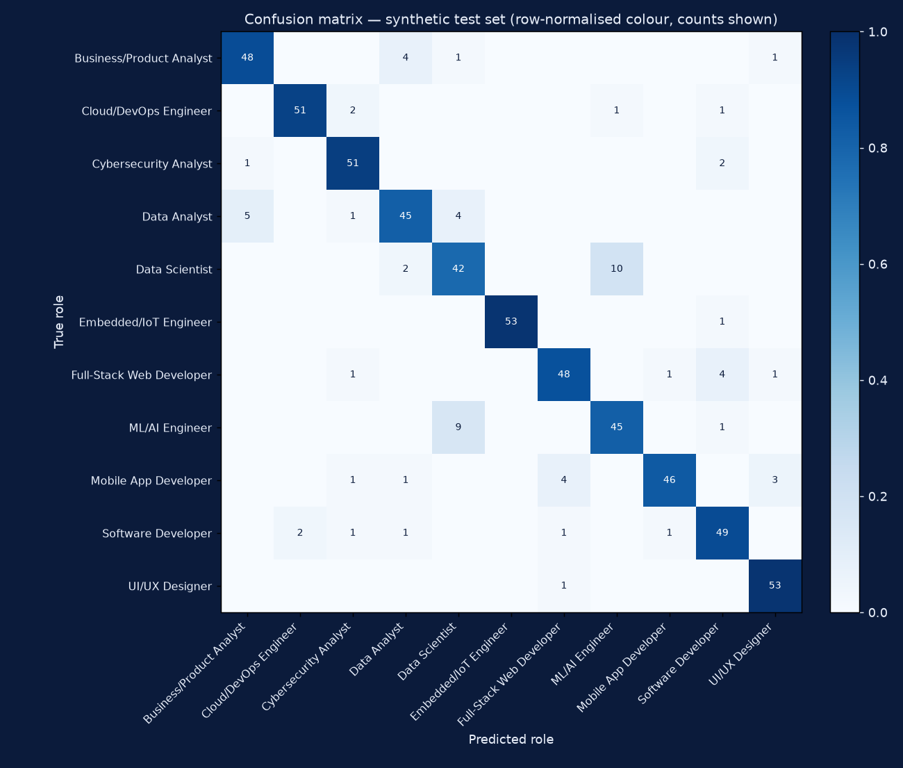

# Model evaluation

> **The training data is synthetic.** No real student data was available, and using real
> students' records would raise privacy concerns. Instead, `src/career/synth.py` generates
> 3,000 fictional students around each role's ideal skill profile in
> `config/roles.yaml`, with noise (fixed seed 42). These numbers show the model
> learns the role profiles well. They are **not** a measure of real-world accuracy.

## Selected model: LogisticRegression

| Metric (test set, 600 rows) | Value |
|---|---|
| Accuracy (top-1) | **0.885** |
| Top-3 accuracy | **0.982** |
| Macro F1 | **0.885** |

## Model comparison

Selected by 5-fold cross-validation on the training set (2400 rows); the test
set is held out and only used for the final numbers.

| Model | CV accuracy | Test accuracy | Test top-3 | Test macro F1 |
|---|---|---|---|---|
| RandomForestClassifier | 0.860 ± 0.011 | 0.868 | 0.980 | 0.868 |
| LogisticRegression ✅ | 0.879 ± 0.013 | 0.885 | 0.982 | 0.885 |

## Setup

- Features (20): 10 skill-area scores (0–100), year of study, CGPA
  (missing → 7.0), and 8 interest flags.
- Split: 80/20 stratified, seed 42.
- Trained 2026-11-24 with scikit-learn 1.9.1.

## Confusion matrix



Most common mix-ups — these are roles with genuinely overlapping skill profiles, which is
why the app shows the **top 3** roles instead of a single answer:

- **Data Scientist** predicted as **ML/AI Engineer**: 10 times
- **ML/AI Engineer** predicted as **Data Scientist**: 9 times
- **Data Analyst** predicted as **Business/Product Analyst**: 5 times
- **Mobile App Developer** predicted as **Full-Stack Web Developer**: 4 times
- **Full-Stack Web Developer** predicted as **Software Developer**: 4 times

## Per-role report

```
                          precision    recall  f1-score   support

Business/Product Analyst      0.889     0.889     0.889        54
   Cloud/DevOps Engineer      0.962     0.927     0.944        55
   Cybersecurity Analyst      0.895     0.944     0.919        54
            Data Analyst      0.849     0.818     0.833        55
          Data Scientist      0.750     0.778     0.764        54
   Embedded/IoT Engineer      1.000     0.981     0.991        54
Full-Stack Web Developer      0.889     0.873     0.881        55
          ML/AI Engineer      0.804     0.818     0.811        55
    Mobile App Developer      0.958     0.836     0.893        55
      Software Developer      0.845     0.891     0.867        55
          UI/UX Designer      0.914     0.981     0.946        54

                accuracy                          0.885       600
               macro avg      0.887     0.885     0.885       600
            weighted avg      0.887     0.885     0.885       600

```

Regenerate with: `PYTHONPATH=src python -m career.train`
